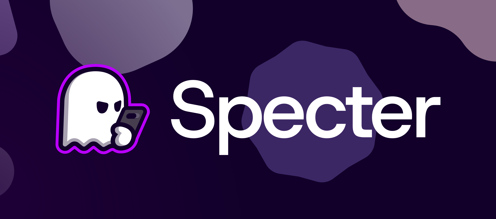

# Specter — ROM port for PixelOS 17.0 (branch `seventeen`)

This branch is a fork of [dpejoh/specter](https://github.com/dpejoh/specter) with Specter ported to
**PixelOS 17.0** (Android 17) as a settings page of the ROM, **without root, KernelSU, a module or shell
scripts**. The module itself (`src/`, `scripts/`, `config/`) is kept as upstream; the port is in
[`rom/`](rom), described in [`rom/NOTICE.md`](rom/NOTICE.md).

## What the port does

The page *Settings > Advanced features > Experimental features > Integrity > Specter* runs the same
update pass as `action.sh`, from the Play Integrity Fix app of the ROM:

1. restarts Google Play services and the Play Store (optionally clears the Play Store data);
2. keeps them among the target apps of the keybox service;
3. sets the security patch from the profile, the device, the security bulletin, a synthetic date or a
   date you enter;
4. checks the keybox against Google's revocation list and takes one from the online catalog or a URL;
5. fetches the profile of a preferred or random Pixel device from the `bot` branch of
   [KOWX712/PlayIntegrityFix](https://github.com/KOWX712/PlayIntegrityFix), skipping blocked devices;
6. optionally turns off developer options and USB debugging (off by default).

A change of the device, the patch source, the keybox provider or the targets is propagated to the Play
Integrity Fix and TEESimulator pages. The pass runs once after the first boot or a reset, then every 6,
12 or 24 hours, and on *Update now*. The main switch is `Settings.Global specter` (on unless 0).

## Requirements on the ROM

The code lives in the Play Integrity Fix app (`io.github.wnduddld0513.pif`), so everything in the
[`PlayIntegrityFix` README](https://github.com/wnduddld0513/PlayIntegrityFix/tree/seventeen#requirements-on-the-rom-pixelos-170--android-17)
applies: the `frameworks/base` hooks and `KeyboxAttestationService`, the SELinux type of the service, and
`PRODUCT_PACKAGES += PlayIntegrityFixSettings`. Build it as described there.

The app needs the privileged permissions `WRITE_SECURE_SETTINGS`, `FORCE_STOP_PACKAGES` and
`CLEAR_APP_USER_DATA` (`privapp-permissions-pif.xml`).

## License

GPL-3.0, like upstream (see [`LICENSE`](LICENSE)).

---

## Upstream: Specter

# Specter

<p align="center">
  
</p>

[](https://github.com/dpejoh/specter/releases/latest)
[](https://github.com/dpejoh/specter/actions/workflows/build-test.yml)

Strong integrity, Tricky Store management, detection cleanup. Clean, focused, no bloat.

[Download](https://github.com/dpejoh/specter/releases/latest)

## Support

- Telegram: [Channel](https://t.me/dpejoh) · [Group](https://t.me/dpejoh0)
- Ko-fi: [ko-fi.com/dpejoh](https://ko-fi.com/dpejoh)
- BTC: bc1qfy4vfstns4aqhvck66x0r53n3hfkkzhwkt7zpw
- ETC: 0x895762C0Fd2BeF54EE3cD478Fc03212aeA673a68

## Quick start

1. Install [Tricky Store](https://github.com/5ec1cff/TrickyStore/releases/latest) /
   [TEESimulator](https://github.com/JingMatrix/TEESimulator/releases/latest) /
   [Tricky Store OSS](https://github.com/beakthoven/TrickyStoreOSS/releases/latest)
   [OhMyKeymint](https://github.com/qwq233/OhMyKeymint/releases/latest)
   (Specter auto-installs Tricky Store OSS if none found)
3. Install [Play Integrity Inject](https://github.com/KOWX712/PlayIntegrityFix/releases/latest)
   or [Play Integrity Fork](https://github.com/osm0sis/PlayIntegrityFork/releases/latest)
4. Install Specter via Magisk / KernelSU / APatch
5. Reboot. First-boot runs backup, target, keybox.
6. Open the WebUI

## Features

- **Keybox**: multi-source catalog, revocation watch with auto-replace, custom keybox, backup/restore
- **Auto Target**: inotify + polling for new apps
- **App Targeting**: per-app states, suffixes
- **Security Patch**: live fetch with offline fallback
- **ROM Fingerprint**: cleans custom ROM props and prefixes
- **ADB Disabler**: dev options, USB debugging, OEM unlock
- **PIF**: auto-detect variant, apply a preferred fingerprint or fetch one
- **GMS Kill**: force-stops DroidGuard/GMS, clears Play Store
- **HMA-OSS**: scope manager page, config generation, auto-update
- **Zygisk Next**: detection and configuration
- **Detection Cleanup**: removes detector logs, temp dirs, caches
- **Widevine L1**: writes DRM attestation keys via KmInstallKeybox
- **Conflict Resolution**: aggressive modules disabled, passive coexists, TEESimulator WebUI feature ownership
- **Scheduler**: keybox revocation watch, auto-target, HMA auto-update, autopif
- **First-Boot**: backup originals, run default actions pipeline once

## Build

```bash
git clone https://github.com/dpejoh/specter
cd specter
npm install
npm run build
```

Output: `Specter-v{version}-g{hash}.zip`

## Translations

The WebUI is translated into Arabic, Spanish, French, Hungarian, Indonesian, Polish, Russian, Turkish, Vietnamese, and Chinese (mostly AI-generated. Human review welcome).

To contribute translations:
- **Preferred**: Join the [Crowdin project](https://crowdin.com/project/specter-module) (web UI, no git needed)
- **Alternative**: Edit the JSON files in `src/webroot/lang/` and submit a PR

## Disclaimer

For educational purposes only. The developer does not condone illegal activities, including bypassing DRM, violating terms of service, or committing fraud; users are solely responsible for complying with applicable laws.

Specter is programmed not to cause problems, but an unlocked phone always comes with risks. Nothing is 100% guaranteed: your warranty may be voided, apps may break, and account bans are possible. Use at your own risk, and always maintain backups of important data.

## Thanks

- [chiteroman](https://github.com/chiteroman/PlayIntegrityFix), [KOWX712](https://github.com/KOWX712/PlayIntegrityFix) and [osm0sis](https://github.com/osm0sis/PlayIntegrityFork). PIF and forks.
- [5ec1cff](https://github.com/5ec1cff/TrickyStore), [JingMatrix](https://github.com/JingMatrix/TEESimulator), [beakthoven](https://github.com/beakthoven/TrickyStoreOSS), [qwq233](https://github.com/qwq233/OhMyKeymint). Tricky Store and forks.
- [KOWX712](https://github.com/KOWX712/Tricky-Addon-Update-Target-List). Tricky Addon.
- [eltavine](https://github.com/eltavine/Duck-Detector-Refactoring). Duck Detector.
- [Citra-Standalone](https://github.com/Citra-Standalone/TSupport-Advance). TSupport-Advance.

## License

GNU GPL v3.0
